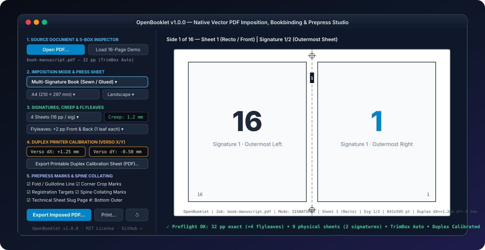
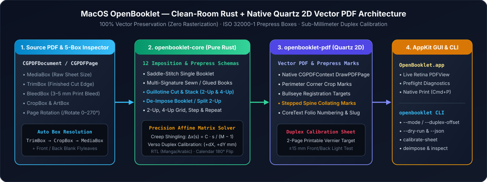

<div align="center">


# MacOS OpenBooklet

**Native Rust + Quartz 2D Vector PDF Imposition, Bookbinding Signatures, Guillotine Cut & Stack & Duplex Printer Calibration Studio for macOS (`OpenBooklet.app` + `openbooklet`)**

[](https://github.com/SilverFeit/MacOS-OpenBooklet/releases/latest)
[](#installation)
[-111827?style=flat-square&logo=apple)](https://github.com/SilverFeit/MacOS-OpenBooklet/releases/latest)
[](#how-clean-room-vector-pdf-imposition-works)
[](#key-features)
[](LICENSE)

```bash
brew install --cask SilverFeit/tap/macos-openbooklet
```

[**Install via Homebrew**](#option-a--homebrew-recommended) · [**Download `.dmg`**](https://github.com/SilverFeit/MacOS-OpenBooklet/releases/latest) · [**CLI (`openbooklet`)**](#command-line-interface-openbooklet) · [**Features**](#key-features) · [**Architecture**](#how-clean-room-vector-pdf-imposition-works) · [**User Guide**](docs/USER_GUIDE.md) · [**Clean-Room Spec**](docs/SPEC.md) · [**Español**](#-español--resumen-del-proyecto)

<br />



</div>

---

## Overview

**MacOS OpenBooklet** is a clean-room, open-source macOS application and command-line suite written in **100% Rust** (`openbooklet-core`, `openbooklet-pdf`, `openbooklet-cli`, `openbooklet-app`) paired directly with Apple's native **AppKit**, **PDFKit**, **CoreGraphics (Quartz 2D)**, and **CoreText** frameworks.

Legacy PDF booklet and imposition tools on macOS typically suffer from one of three flaws: broken Linux Python/GTK3/Poppler dependency chains, bloated Electron/Java runtimes, or rasterizing pipelines that convert crisp typography into blurry bitmaps.

**MacOS OpenBooklet takes the native vector path:** every source page is inspected across all five ISO 32000-1 PDF boundary boxes (`MediaBox`, `CropBox`, `BleedBox`, `TrimBox`, `ArtBox`) and transformed vectorially via `CGPDFContext` and affine matrices in milliseconds — preserving **100% vector curves, embedded fonts, CMYK/RGB color profiles, and zero external runtime dependencies**.

<details>
<summary><strong>🇪🇸 Español — Resumen del Proyecto (Haz clic para desplegar)</strong></summary>

<br />

**MacOS OpenBooklet** es un estudio nativo de imposición de PDF, encuadernación artesanal (*bookbinding*) y pre-impresión para macOS + línea de comandos (`openbooklet`), desarrollado **100% en Rust** desde cero (*clean-room*) bajo **licencia MIT** e integrado directamente con **AppKit, PDFKit, CoreGraphics (Quartz 2D) y CoreText**.

- **Instalación Directa por Homebrew (`brew`) o `.dmg`:** Instala tanto **`/Applications/OpenBooklet.app`** como el binario de terminal **`openbooklet`** con `brew install --cask SilverFeit/tap/macos-openbooklet`.
- **12 Modos de Imposición y Reversión:**
  - **Libreto Simple (*Saddle-Stitch Booklet*)** y **Cuadernillos Múltiples (*Multi-Signature Books*)** para costura francesa, copta o encuadernación fresada/encolada.
  - **Modo Guillotina *"Cut & Stack"* (2-Up y 4-Up):** Imprime a doble cara, corta por el centro con guillotina, apila la columna izquierda sobre la derecha y obtén el bloque ordenado del `1` al `N` sin doblar hojas.
  - **Des-imponer / Revertir Libreto (*De-Impose Booklet* y *Split 2-Up*):** Toma un PDF que ya viene impuesto como libreto o pliego doble y lo devuelve automáticamente a páginas individuales en orden de lectura secuencial (`1, 2, 3...`).
  - **2-Up, 4-Up (Filas y Columnas), Repetición de Copias (*Step & Repeat*) y 1-Up Prepress.**
- **Las 6 Mejoras Profesionales Integradas:**
  1. **Calibración Dúplex de Impresora (`Verso dX / dY mm` + Hoja de Calibración Imprimible):** Corrige al sub-milímetro el desajuste físico entre cara y dorso de cualquier impresora doméstica o de oficina e incluye generador de hoja de prueba con regla vernier (`openbooklet calibrate-sheet`).
  2. **Corte y Apilado (*Guillotine Cut & Stack* 2-Up / 4-Up)** con línea guía de guillotina e instrucciones en la tira técnica.
  3. **Des-imposición Lineal (*De-Impose / Linearize*)** para recuperar el orden de lectura de libretos existentes.
  4. **Marcas de Colación Escalonadas en el Lomo (*Spine Collating Marks*):** Bloques negros numerados y escalonados en el pliegue exterior de cada cuadernillo para detectar al instante si falta un pliego o está invertido antes de coser.
  5. **Hojas de Guarda Automáticas (*Flyleaves / Endpapers*):** Inserta hojas de cortesía en blanco al inicio y al final del libro sin modificar el PDF original.
  6. **Inspector de las 5 Cajas de Imprenta (`MediaBox`, `CropBox`, `TrimBox`, `BleedBox`, `ArtBox`):** Detecta automáticamente si el PDF tiene `TrimBox` de diseñador y alinea las marcas de corte al borde final.

</details>

---

## Why Clean-Room Rust + Native Quartz 2D Beats Legacy Imposers

| Capability | **MacOS OpenBooklet** *(Rust + Quartz 2D + AppKit)* | Legacy Python / GTK / Java / Web Tools |
| :--- | :--- | :--- |
| **PDF Rendering Pipeline** | **100% Native Vector Quartz 2D (`CGPDFContext`)** — preserves fonts, vectors & CMYK | Often rasterizes pages or strips PDF prepress boxes |
| **Runtime Dependencies** | **Zero** (`~500 KB` pure Rust + macOS system frameworks) | Requires Python, GTK3, Poppler, PyQt, Java JRE, or Chromium |
| **Duplex Printer Calibration** | **Sub-millimeter Verso X/Y shift + Printable 2-Page Vernier Calibration Sheet** | Rarely included; requires manual trial-and-error |
| **Guillotine Cut & Stack** | **Built-in 2-Up & 4-Up Cut & Stack with Verso back-to-back column mirroring** | Booklet-only or requires commercial prepress software |
| **De-Impose / Un-Booklet** | **One-click / one-command `deimpose` & `split-2up` back to `1..N` reading order** | Requires separate page-splitting utilities |
| **Bookbinding Spine Verification** | **Stepped & numbered Spine Collating Marks + Automatic Front/Back Flyleaves** | Manual calculation or missing |
| **License & Provenance** | **Clean-room MIT License (`SilverFeit`)** | GPL / AGPL copyleft or proprietary |

---

## Key Features

### 1. Twelve Imposition, Cut-and-Stack & De-Imposition Modes
- **Single Booklet (`booklet`):** Classic saddle-stitch imposition (`4` pages per folded sheet, outermost to centerfold).
- **Multi-Signature Books (`signatures`):** Splits thick books into configurable quires (`1` to `16` folded sheets = `4` to `64` pages per signature) for hand-sewn (Coptic, French link, Smyth) or perfect-bound books.
- **Guillotine Cut & Stack (`cut-stack-2up`, `cut-stack-4up`):** Designed for ring-bound manuals, notepads, tickets, and stack-cut books that are **cut with a guillotine rather than folded**. Automatically mirrors Verso horizontal columns so every front page aligns with its exact back page when cut down the center and stacked.
- **De-Impose Booklet & Split 2-Up Spreads (`deimpose`, `split-2up`):** Takes an already-imposed 2-up booklet or scanned double-page spread PDF, crops each spread cleanly in half, and reconstructs sequential `1, 2, 3, ..., N` single pages.
- **N-Up & Step-and-Repeat (`2up`, `4up-rows`, `4up-cols`, `2-copies`, `4-copies`, `1up`):** Flexible grid imposition and duplicate flyer/card printing.

### 2. Duplex Printer Calibration (`Verso dX / dY mm`) + Printable Vernier Sheet
- Consumer and office laser/inkjet duplexers almost always shift the back side (`Verso`) by `0.5 mm` to `2.5 mm` relative to the front side (`Recto`).
- **MacOS OpenBooklet** lets you export a **2-Page Printable Duplex Calibration Sheet** (`Cmd+K` or `openbooklet calibrate-sheet calibration.pdf`). Print it duplex at 100% scale, hold the sheet against a light source to see where the crimson Back-Side crosshair lands on the Front-Side millimeter ruler, and enter those `Verso dX / dY (mm)` values to achieve dead-on front-to-back registration.

### 3. Bookbinding Craft Extras: Creep Shingling, Spine Collating Marks & Flyleaves
- **Progressive Creep (Shingling) Compensation:** Shifts inner sheets progressively toward the spine (`Δx(s) = C · s / (M - 1)`) so outer margins trim flush even on thick signatures.
- **Stepped Spine Collating Marks:** Prints a stepped black block with micro-numbered signature index (`1`, `2`, `3`...) on the outer spine fold of each signature. When all folded signatures are stacked together, the marks form a continuous diagonal staircase down the spine — making a missing, duplicated, or inverted signature immediately visible before sewing.
- **Automatic Front & Back Flyleaves (Endpapers):** Prepend and append `2`, `4`, or `8` blank protective endpaper pages without editing your source PDF.

### 4. ISO 32000-1 Prepress 5-Box Inspector (`MediaBox`, `CropBox`, `TrimBox`, `BleedBox`, `ArtBox`)
- Inspects all five PDF boundary boxes on every page (`openbooklet inspect file.pdf --json`).
- In **`Auto`** mode, automatically frames pages to `TrimBox` when present (falling back to `CropBox` then `MediaBox`), and aligns perimeter **Corner Crop Marks**, **Registration Bullseye Targets**, and **Technical Sheet Slugs** with mathematical precision.

---

## Installation

### Option A — Homebrew (Recommended)

Installs both **`/Applications/OpenBooklet.app`** and **`/opt/homebrew/bin/openbooklet`** (and clears Gatekeeper quarantine automatically):

```bash
brew install --cask SilverFeit/tap/macos-openbooklet
```

To update to the latest version at any time:

```bash
brew upgrade --cask macos-openbooklet
```

### Option B — Download Prebuilt `.dmg` / `.zip`

1. Go to [**GitHub Releases (`latest`)**](https://github.com/SilverFeit/MacOS-OpenBooklet/releases/latest).
2. Download **`MacOS-OpenBooklet-1.0.0.dmg`** *(or `MacOS-OpenBooklet-1.0.0.app.zip`)*.
3. Open the `.dmg`, drag **OpenBooklet** into **Applications**, and launch it.

> [!NOTE]
> **First Launch via Manual Download (Gatekeeper):** Because open-source builds use ad-hoc signing rather than a paid Developer ID certificate, if you install manually via `.dmg`/`.zip` instead of Homebrew, right-click `OpenBooklet.app` → **`Open`** → **`Open`** (or run `xattr -cr "/Applications/OpenBooklet.app"`). To add `openbooklet` to your `PATH` on manual installs:
> ```bash
> ln -sf "/Applications/OpenBooklet.app/Contents/MacOS/openbooklet" /opt/homebrew/bin/openbooklet
> ```

### Option C — Build from Source

Requires macOS 14+ on Apple Silicon with Rust (`cargo` / `rustc`) and Xcode Command Line Tools:

```bash
git clone https://github.com/SilverFeit/MacOS-OpenBooklet.git
cd MacOS-OpenBooklet

# Run clean-room core + vector PDF round-trip test suite
cargo test

# Build Release OpenBooklet.app + openbooklet CLI + .dmg + .app.zip + SHA256SUMS.txt
./Scripts/package_release.sh
```

---

## Command-Line Interface (`openbooklet`)

`openbooklet` is bundled inside `OpenBooklet.app/Contents/MacOS/openbooklet` and supports full scripting, `--dry-run` sheet verification, and `--json` output for automated prepress pipelines:

```bash
# List all 12 imposition & prepress modes
openbooklet modes

# Inspect PDF page count & ISO 32000-1 prepress boxes (MediaBox, TrimBox, BleedBox, CropBox)
openbooklet inspect manuscript.pdf
openbooklet inspect manuscript.pdf --json

# Generate a 2-page printable Duplex Vernier Calibration Sheet
openbooklet calibrate-sheet duplex-calibration.pdf --paper a4

# Create a standard saddle-stitch booklet on A4 with crop marks
openbooklet manuscript.pdf booklet.pdf --mode booklet --paper a4 --crop-marks

# Multi-signature sewn book (16 pages / 4 sheets per signature, 1.2 mm creep, +2 front/back flyleaves, spine collating marks & duplex calibration)
openbooklet book.pdf signatures.pdf \
  --mode signatures \
  --folios 4 \
  --creep 1.2 \
  --flyleaves 2,2 \
  --duplex-offset 1.25,-0.50 \
  --all-marks \
  --page-numbers bottom-outer

# Guillotine 2-Up Cut & Stack (cut down the center and stack left pile onto right pile)
openbooklet manual.pdf cut-and-stack.pdf --mode cut-stack-2up --paper letter --slug

# Reverse an already-imposed booklet PDF back into sequential 1..N single pages
openbooklet deimpose imposed-booklet.pdf linear-reading.pdf

# Split 2-Up scanned spreads into individual pages (supports --rtl for Manga/Arabic)
openbooklet deimpose scanned-spreads.pdf single-pages.pdf --split-2up

# Preview the exact sheet/side/signature slot matrix in the terminal without writing a PDF
openbooklet book.pdf --mode signatures --folios 4 --dry-run
```

---

## How Clean-Room Vector PDF Imposition Works

<div align="center">

</div>

**MacOS OpenBooklet** separates pure mathematical imposition logic from native Apple Quartz 2D vector PDF rendering across four modular Rust crates:

1. **`openbooklet-core` (Zero-Dependency Pure Rust Engine):** Computes page-range filtering, front/back flyleaf injection, automatic blank padding, signature partitioning, saddle-stitch / cut-and-stack / de-imposition slot matrices, progressive creep shingling (`Δx(s)`), Verso duplex calibration offsets, and preflight diagnostics.
2. **`openbooklet-pdf` (Quartz 2D `CoreGraphics` + `CoreText` Vector Engine):** Reads all 5 ISO 32000-1 boundary boxes (`CGPDFPageGetBoxRect`), clips and transforms source pages directly into vector output sheets (`CGPDFContextCreateWithURL` + `CGContextDrawPDFPage`), draws prepress marks and stepped spine collating blocks, and generates the printable Duplex Vernier Calibration Sheet.
3. **`openbooklet-cli` (`openbooklet`):** Fast, scriptable command-line interface with `--dry-run` ASCII tables and `--json` telemetry.
4. **`openbooklet-app` (`OpenBooklet.app`):** Native macOS `AppKit` + `PDFKit` desktop studio with live Retina `PDFView` preview, instant sheet/side navigation, and native macOS printing (`Cmd+P`).

Read the [**Full User Guide (`docs/USER_GUIDE.md`)**](docs/USER_GUIDE.md), [**Clean-Room Mathematical Specification (`docs/SPEC.md`)**](docs/SPEC.md), and [**Changelog (`CHANGELOG.md`)**](CHANGELOG.md) for complete details.

---

## Requirements & Compatibility

- **Mac Architecture:** Apple Silicon (`arm64` — M1, M2, M3, M4, and newer).
- **Operating System:** macOS 14.0 Sonoma or later.
- **Permissions & Privacy:** **100% Offline & Local.** Zero network requests, zero telemetry, zero background daemons, and zero special macOS TCC permissions required. Multi-user ready (`0755` POSIX permissions) when installed in `/Applications`.

---

## Project Structure

```text
MacOS-OpenBooklet/
├── Cargo.toml                           # Rust Workspace (openbooklet-core + pdf + cli + app)
├── VERSION                              # Single source of truth for release & bundle version (1.0.0)
├── Casks/macos-openbooklet.rb            # Homebrew Cask definition (synced with SilverFeit/homebrew-tap)
├── crates/
│   ├── openbooklet-core/                 # Pure Rust imposition, cut-and-stack, de-impose, creep & preflight engine
│   ├── openbooklet-pdf/                  # Native CoreGraphics / CoreText vector PDF renderer & 5-box inspector
│   ├── openbooklet-cli/                  # Command-line interface (`openbooklet`) with --dry-run & --json
│   └── openbooklet-app/                  # Native macOS AppKit + PDFKit GUI (`OpenBooklet.app`) in pure Rust
├── Scripts/                             # App + CLI bundle builder, Rust CoreGraphics .icns generator & DMG packager
└── docs/                                # User Guide, Clean-Room Mathematical Spec (`SPEC.md`) & SVG/PNG assets
```

---

## License

Released under the [MIT License](LICENSE). Copyright © 2026 [SilverFeit](https://github.com/SilverFeit).

---

<div align="center">

**Topics & Hashtags**

`#macOS` `#OpenBooklet` `#PDFImposition` `#Bookbinding` `#BookletMaker` `#Prepress` `#CutAndStack` `#DuplexCalibration` `#Rust` `#AppKit` `#PDFKit` `#Quartz2D` `#ZineMaking` `#IndiePublishing` `#PrintProduction` `#Homebrew` `#CLI` `#AppleSilicon` `#MacUtilities` `#OpenSource`

</div>
